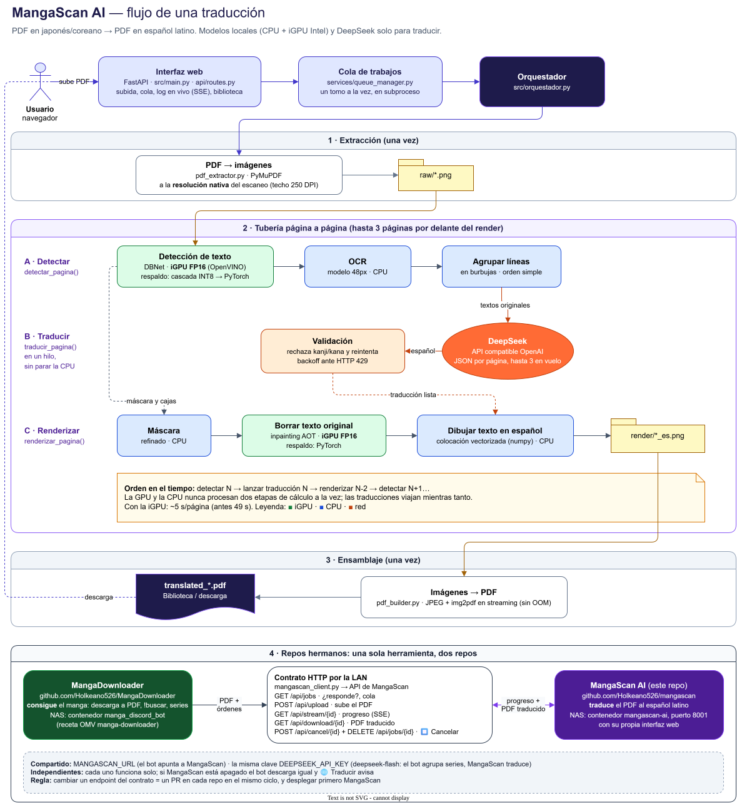

# MangaScan AI — Traductor de manga local (japonés/coreano → español latino)


Herramienta de código abierto que **detecta, lee, traduce y redibuja** los textos de un manga en PDF y devuelve el PDF en español latino, de forma desatendida.

Todo el procesamiento de imagen (detección de globos, OCR, borrado del texto original y dibujo del texto nuevo) corre **en local**, en CPU y opcionalmente en la **GPU integrada de Intel** con OpenVINO. Solo la traducción se delega a la API de **DeepSeek V4 Flash** (o cualquier API compatible con OpenAI).

Está pensada para un NAS o un HomeLab con poca RAM y sin GPU dedicada.

## Características

- **Calidad de origen:** cada página se extrae a la **resolución nativa** del escaneo, sin ampliarla ni recomprimirla de más.
- **Visión local:** usa [manga-image-translator](https://github.com/zyddnys/manga-image-translator) para detectar los globos, leer el texto (OCR) y borrarlo de la imagen, sin coste de API.
- **Aceleración por iGPU Intel:** el detector y el borrado (inpainting) corren en la GPU integrada con OpenVINO FP16. Si la GPU no existe o falla, usa la CPU sola.
- **Traducción con contexto:** envía todos los textos de una página juntos en un JSON, para que el modelo traduzca con el contexto de la escena.
- **Validación anti-asiática:** si el modelo devuelve kanji, kana o hanzi en la traducción, la rechaza y reintenta.
- **Tubería en paralelo:** mientras DeepSeek traduce una página, la CPU y la GPU ya trabajan en las siguientes.
- **Apta para un NAS:**
  - Modelos cargados una sola vez y memoria acotada por página.
  - PDF ensamblado en streaming, sin cargar todo el tomo en RAM.
- **Interfaz web 100 % offline:** cola de trabajos, log en vivo, biblioteca y descargas. Las fuentes están autohospedadas: sin CDN ni Google Fonts.

---

## ⚙️ Flujo de la aplicación

<p align="center">
  
</p>

> El diagrama es un `.drawio.svg`: se ve en GitHub y se edita abriéndolo directamente en [draw.io](https://app.diagrams.net/) o en draw.io Desktop. La fuente también está en [`docs/flujo_app.drawio`](docs/flujo_app.drawio).

Cada tomo pasa por tres fases:

1. **Extracción (una vez).** `pdf_extractor.py` convierte cada página en PNG a la resolución de su imagen escaneada, con 250 DPI como techo. Los PDF de manga suelen ser una imagen por página; renderizarlos a DPI fijo los ampliaba hasta 6,8 veces sin ganar detalle.
2. **Tubería página a página.** `orquestador.py` encadena tres etapas y mantiene hasta 3 páginas detectadas por delante del render. Orden: detectar N → lanzar la traducción de N → renderizar N‑2 → detectar N+1…
   - **A · Detectar** (`detectar_pagina`): detección de texto (DBNet, en la iGPU), OCR (modelo `48px`, CPU) y agrupado de líneas en burbujas.
   - **B · Traducir** (`traducir_pagina`): petición a DeepSeek en un hilo, para que la CPU no espere. Incluye reintentos con *backoff* ante `HTTP 429` y la validación anti-asiática.
   - **C · Renderizar** (`renderizar_pagina`): refinado de la máscara, borrado del texto original (inpainting AOT, en la iGPU) y dibujo del texto en español.
3. **Ensamblaje (una vez).** `pdf_builder.py` comprime las páginas a JPEG y las cose con `img2pdf` en streaming. El PDF final queda en la Biblioteca de la web.

Las páginas sin texto se copian tal cual. Si una página falla, se conserva la original y el resto del tomo sigue.

### Módulos

| Archivo | Función |
|---|---|
| `src/main.py`, `src/api/routes.py` | Servidor FastAPI: interfaz web, subida, log en vivo (SSE), biblioteca, descargas y cancelación. |
| `src/services/queue_manager.py` | Cola de trabajos. Lanza un tomo a la vez en un subproceso. |
| `src/orquestador.py` | Director del pipeline: extracción, tubería por páginas, ensamblaje y resumen. |
| `src/pdf_extractor.py` | PDF → PNG a resolución nativa (`zoom_nativo`). |
| `src/translator_engine.py` | Motor: mantiene vivo manga-image-translator (singleton), separa detección, traducción y render, y llama a DeepSeek. |
| `src/aceleracion.py` | Detector e inpainting en la iGPU Intel (OpenVINO FP16), con caché de kernels y vuelta a CPU. |
| `src/detector_cascada.py` | Elección del detector: iGPU → cascada INT8 en CPU (INT8 propone, PyTorch confirma las zonas dudosas) → PyTorch. |
| `src/optimizaciones_mit.py` | Parches de velocidad sobre manga-image-translator con **resultado idéntico**, como la colocación de textos vectorizada. |
| `src/pdf_builder.py` | Ensamblaje del PDF sin picos de memoria. |
| `src/rescue.py` | Rehace el PDF final si un trabajo terminó las páginas pero falló al ensamblar. |
| `tools/` | Regenerar los modelos de OpenVINO (`convertir_modelos_openvino.py`, `cuantizar_detector_int8.py`) y evaluar la cascada. |

---

## 🚀 Rendimiento

Medido en un NAS con **Intel Core i5-1135G7** (4 núcleos, iGPU Iris Xe) y 4 CPU asignadas al contenedor, en régimen estable:

| Versión | s/página | Tomo de 151 páginas |
|---|---|---|
| Original (2 CPU, extracción a 250 DPI, pasos en serie) | 49 | 2 h 6 min |
| Resolución nativa + 4 CPU + DeepSeek en paralelo | 13,2 | ~33 min |
| + detector INT8 en cascada + peticiones inmediatas | 10,4 | ~26 min |
| + **detector e inpainting en la iGPU** | **5,2** | **~15 min** |

Las páginas con mucho texto tardan más, porque el OCR corre en CPU.

**Cómo se comprobó la calidad:**

| Componente | Comparado con PyTorch en CPU |
|---|---|
| Detector en iGPU | 0 de 220 cajas de texto perdidas, sin falsos positivos |
| Inpainting en iGPU | diferencia media 0,004/255 por píxel |
| Parches de `optimizaciones_mit.py` | páginas idénticas píxel a píxel |

---

## Requisitos

- Docker (recomendado) o Linux con **Python 3.11**.
- Una API key de **DeepSeek** (o de otro proveedor compatible con OpenAI).
- Opcional: CPU Intel con **GPU integrada** (Gen12 / Tiger Lake o posterior) para la aceleración.

---

## 🐳 Instalación con Docker (recomendada)

El motor de visión (`manga-image-translator`) depende de librerías nativas pesadas (PyTorch, numpy 1.26, pydensecrf) que no tienen binarios para Python reciente. **Docker es la forma soportada**: la imagen ya trae Python 3.11 y todo compilado.

1. **Clonar el repositorio**
   ```bash
   git clone https://github.com/Holkeano526/mangascan.git
   cd mangascan
   ```

2. **Configurar la API key** en un archivo `.env` junto a `docker-compose.yml`:
   ```env
   DEEPSEEK_API_KEY=sk-tu_api_key_aqui
   ```
   > ⚠️ **No** la escribas en `docker-compose.yml`: ese archivo está en git y la publicarías.

3. **Levantar el servicio**
   ```bash
   docker compose up --build -d
   ```

4. **Traducir:** abre **http://localhost:8001**, sube un PDF, sigue el progreso en vivo y descárgalo desde la Biblioteca.

> 💡 Los modelos (varios GB) se guardan en `./config`, así no se descargan de nuevo al recrear el contenedor.

### Aceleración con la iGPU Intel (opcional)

1. **Driver en la imagen.** Usa `Dockerfile.nas`, que añade el runtime oficial de Intel (`compute-runtime` + IGC, verificados por SHA-256 en `tools/igpu.sha256`). Debian 13 no lo incluye, y la rama "legacy1" de Intel no reconoce Tiger Lake.
2. **Acceso a la GPU.** En `docker-compose.yml`, descomenta el bloque de la GPU (`/dev/dri` y el grupo `render` del host). El número del grupo se obtiene con `getent group render`.
3. **Modelos.** Genera los modelos de OpenVINO en `./config/models/openvino/` con `tools/convertir_modelos_openvino.py`. Necesita más de 4 GB de RAM; el comando está en la cabecera del script.
4. **Memoria.** Con GPU, da al contenedor **6 GB**: los búferes de la iGPU cuentan como memoria compartida del contenedor (~1,8 GB).

Al arrancar, el log muestra `Detector: iGPU Intel (OpenVINO FP16)` e `Inpainting: iGPU Intel (OpenVINO FP16)`. La primera vez se compilan los kernels (~15 s); después se cargan de la caché en `./config/cache/openvino`.

> Si la GPU la usa también un servidor multimedia (por ejemplo Jellyfin con QSV), MangaScan irá algo más lento mientras coincidan, sin perder calidad.

### Imagen congelada (despliegue en NAS)

La rama `main` de manga-image-translator exige hoy Python 3.12. Por eso `Dockerfile` la fija al commit `95227a2b`, y el despliegue del NAS usa `Dockerfile.nas` sobre una imagen base ya construida y probada (`mangascan-ai:base-20260817`), a la que solo añade capas.

---

## ⚙️ Variables de entorno

| Variable | Por defecto | Para qué |
|---|---|---|
| `DEEPSEEK_API_KEY` | — | Clave de la API de traducción (obligatoria). |
| `DEEPSEEK_API_URL` | `https://api.deepseek.com/chat/completions` | Cualquier endpoint compatible con OpenAI. |
| `DEEPSEEK_MODEL` | `deepseek-v4-flash` | Nombre del modelo. |
| `MANGASCAN_DETECTOR` | `auto` | `auto` (iGPU → cascada INT8 → PyTorch), `gpu`, `cascada` o `pytorch`. |
| `MANGASCAN_GPU` | `1` | `0` desactiva la iGPU. |
| `MANGASCAN_ADELANTO` | `3` | Páginas detectadas por delante del render (traducciones simultáneas). |
| `OMP_NUM_THREADS`, `MKL_NUM_THREADS` | `4` | Hilos de inferencia en CPU. Iguálalos a las CPU asignadas y a los núcleos **físicos**: con más hilos que CPU, el contenedor se frena a sí mismo. |

### Usar otra IA (OpenAI, Anthropic, Gemini, modelos locales)

```env
DEEPSEEK_API_URL="https://api.openai.com/v1/chat/completions"
DEEPSEEK_API_KEY="sk-tu_nueva_clave"
DEEPSEEK_MODEL="gpt-4o-mini"
```

Con LM Studio u Ollama, la URL sería del tipo `http://localhost:1234/v1/chat/completions`.

### Ajustar el estilo de la traducción

Edita la constante `SYSTEM_PROMPT` en `src/translator_engine.py`: tono, honoríficos, lenguaje neutro, etc.

### Sensibilidad de la detección

Los umbrales están en `_get_config` de `src/translator_engine.py`: `cfg.detector.text_threshold` y `cfg.detector.box_threshold`. La configuración se comparte entre detección y render, así que solo hay que cambiarla en un sitio. Más detalles en la [documentación de manga-image-translator](https://github.com/zyddnys/manga-image-translator).

---

## 💻 Instalación local (avanzado)

Solo en **Linux con Python 3.11**:

```bash
python3.11 -m venv venv && source venv/bin/activate
git clone https://github.com/zyddnys/manga-image-translator.git
(cd manga-image-translator && git checkout 95227a2bb0fd306cd4f0c104d57284026f991b3a && pip install -r requirements.txt)
export PYTHONPATH="$PWD/manga-image-translator"
pip install .
echo 'DEEPSEEK_API_KEY="sk-tu_api_key_aqui"' > .env
uvicorn src.main:app --host 0.0.0.0 --port 8000
```

También se puede traducir sin la web:

```bash
python -m src.orquestador tomo.pdf --work-dir ./work/tomo --output tomo_es.pdf
```

---

## 🚑 Script de rescate (`rescue.py`)

Si un trabajo tradujo todas las páginas pero falló al **ensamblar el PDF** (por ejemplo, por un reinicio), `rescue.py` rehace el PDF a partir de las páginas ya traducidas, sin volver a traducir:

```bash
docker exec mangascan-ai python src/rescue.py
```

---

## 🧪 Tests

```bash
pip install pytest pymupdf numpy requests Pillow python-dotenv fastapi uvicorn python-multipart
pytest
```

Cubren la lógica pura, sin modelos de ML:
- el parseo de la traducción,
- la resolución nativa,
- la equivalencia exacta de la colocación de textos vectorizada,
- que los módulos importan.

La CI los ejecuta en cada PR.

---

## ⚠️ Limitaciones conocidas

- **Idiomas:** el OCR `48px` está pensado para japonés y coreano, y algo de chino. No sirve para todos los idiomas asiáticos; con tailandés, por ejemplo, da basura.
- **Onomatopeyas (SFX):** las integradas en el dibujo se respetan tal cual, porque el detector está entrenado con globos convencionales.
- **Globos muy juntos:** se pueden fusionar diálogos contiguos. Ajusta los umbrales de detección.
- **Espacio en disco:** las imágenes intermedias de PDF grandes ocupan bastante hasta que se borran al terminar.

---

**Desarrollado para el procesamiento masivo y desatendido en servidores NAS y HomeLabs.**

## Licencia

**GNU General Public License v3.0 (GPL-3.0).** Se puede usar, modificar y distribuir libremente, siempre que los derivados también sean de código abierto bajo esta licencia. Ver [`LICENSE`](LICENSE).
